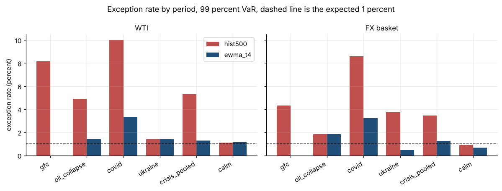
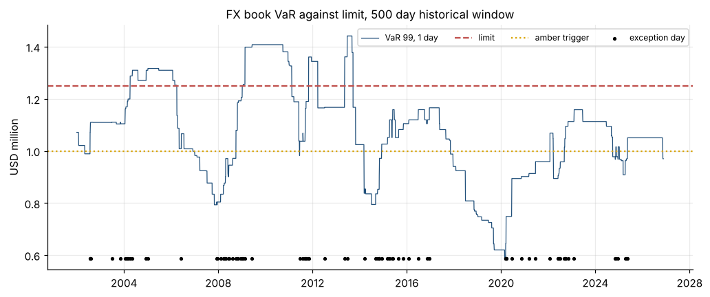
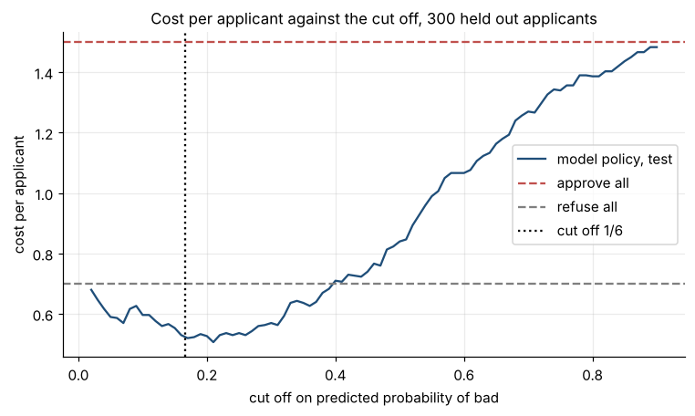
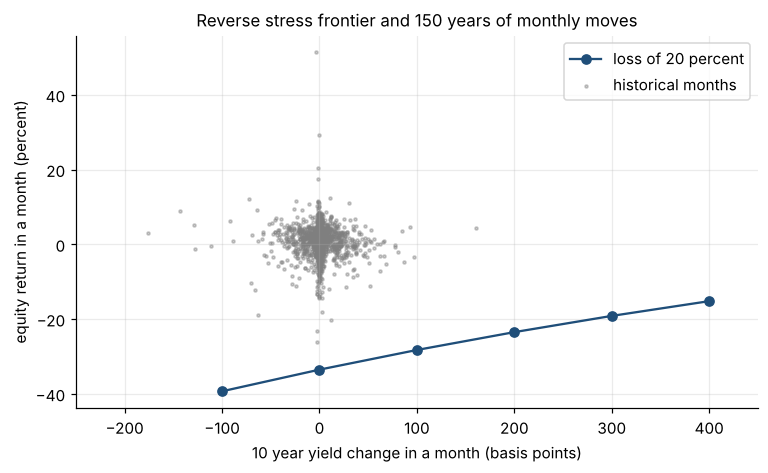

# Open Risk Management

[](https://github.com/robotjaol/open-risk-management/actions/workflows/python-tests.yml)
[](https://github.com/robotjaol/open-risk-management/actions/workflows/notebook-validation.yml)


A paper driven, open learning lab for risk management, with banking as the main specialization. It has four parts that follow the work of a bank risk analyst: foundational thinking (methods built from scratch), practical method (the same methods against a library), daily activity (a desk report with limits, data checks and an action), and research simulation (hypotheses and acceptance criteria written before the result is read, run on real open data).

**Current state, stated plainly.** 12 of 114 planned topics are built: 8 method modules on synthetic or illustrative data, and 4 applied case studies on real open data. 4 modules are Complete by the repository criteria and 8 are Validating. Nothing here has been independently reviewed, and the CI badges show a status only after the first push to GitHub. Read [limitations_and_disclaimers.md](docs/limitations_and_disclaimers.md) before relying on any number.

## What the case studies found

Each case study states hypotheses and acceptance criteria first, then runs. Full text, code and saved results are in the notebooks.

| Case | Data | Decision it supports | Main result |
|---|---|---|---|
| [var_crisis_research](12_end_to_end_banking_projects/var_crisis_research/README.md) | WTI daily 1986 to 2026, FX 10 currencies from 2000 | Is a 500 day historical VaR safe in a crisis? | Crisis exception rate 5.3 percent (WTI) and 3.5 percent (FX) against 1 percent expected. An EWMA t(4) VaR gives 1.3 percent on both. Both pre stated hypotheses hold |
| [daily_market_risk_desk](12_end_to_end_banking_projects/daily_market_risk_desk/README.md) | FX daily, book of USD 100 million in 6 currencies | Is the book inside its limit today, and what is cut if not? | VaR 99 percent 1 day is USD 0.97 million against a USD 1.25 million limit (78 percent). The limit would have been red on 19 percent of days. To bring VaR to 90 percent of the limit, a targeted cut of USD 18.25 million in one currency does the work of a USD 21.96 million pro rata cut |
| [credit_decision_cutoff](12_end_to_end_banking_projects/credit_decision_cutoff/README.md) | German Credit, 1000 applicants | Where to set the approval cut off? | Test AUC 0.796. At the cost derived cut off 1/6, cost per applicant is 0.52, against 1.50 approve all and 0.70 refuse all. With a 5 percent bad rate and no correction the model is worse than approving everyone |
| [historical_stress_replay](12_end_to_end_banking_projects/historical_stress_replay/README.md) | Shiller S&P 500 and 10 year yield, monthly from 1871 | What does history say a bad year costs today, and how far is the loss limit? | Worst 12 month replay loses 36.0 percent. The 240 month VaR was exceeded 26 times against 15.9 expected (Kupiec p = 0.020) |

The illustrative limit in the desk case, the 20 percent loss appetite in the stress case and the 5 to 1 cost ratio in the credit case are stated assumptions, not rules of any institution.

<p>


</p>
<p>


</p>

## Method modules

| Module | Status | Data | What it shows |
|---|---|---|---|
| [probability_of_default](02_credit_risk/probability_of_default/README.md) | Complete | synthetic | logistic regression from scratch, AUC, Gini, KS, Brier, calibration |
| [credit_scoring](02_credit_risk/credit_scoring/README.md) | Validating | synthetic | WoE and IV, scorecard scaling, PSI under drift. One acceptance check fails and is reported |
| [expected_credit_loss](02_credit_risk/expected_credit_loss/README.md) | Complete | synthetic | IFRS 9 style three stage ECL with scenario weighting |
| [duration_and_convexity](03_market_risk/duration_and_convexity/README.md) | Validating | illustrative | bond sensitivity, hedging with DV01 |
| [historical_var](03_market_risk/historical_var/README.md) | Validating | synthetic | empirical VaR, rolling windows, bootstrap |
| [parametric_var](03_market_risk/parametric_var/README.md) | Validating | synthetic | normal, t and EWMA VaR, Monte Carlo cross check |
| [expected_shortfall](03_market_risk/expected_shortfall/README.md) | Complete | synthetic | ES estimators, closed forms, subadditivity |
| [backtesting](03_market_risk/backtesting/README.md) | Complete | synthetic | Kupiec, Christoffersen, traffic light, test power |

The live table with evidence columns is [docs/project_status.md](docs/project_status.md). Status is computed, not typed: see [methodology_standards.md](docs/methodology_standards.md).

## Quick start

```bash
git clone https://github.com/robotjaol/open-risk-management.git
cd open-risk-management
python -m venv .venv && source .venv/bin/activate
pip install -e ".[development]"
make test
jupyter lab
```

In JupyterLab open any notebook, for example `12_end_to_end_banking_projects/credit_decision_cutoff/credit_decision_cutoff.ipynb`, and choose Run, Restart Kernel and Run All Cells. Every notebook runs from a clean kernel. To run all of them from the command line use `make notebooks`. Full steps with expected results: [getting_started.md](docs/getting_started.md).

The real datasets are committed with a card and a checksum. To download them again from the original sources use `make fetch-data`. The download needs internet access and is not needed to run the notebooks.

## Datasets

| Dataset | Kind | License | Source |
|---|---|---|---|
| german_credit | real | CC BY 4.0 | UCI Statlog German Credit, [doi 10.24432/C5NC77](https://doi.org/10.24432/C5NC77) |
| wti_spot_daily, fx_daily_2000, sp500_shiller_monthly | real | ODC-PDDL-1.0 | github.com/datasets, from EIA, Federal Reserve and Shiller sources |
| retail_loans_dev, retail_loans_monitoring, loan_book, market_returns | synthetic | MIT | generated in this repository |

Cards, checksums and leakage notes: [datasets/README.md](datasets/README.md). Sources: [research/source_register.md](research/source_register.md).

## Research

[Literature review](research/literature_review.md), [source register with DOIs](research/source_register.md), [paper catalog](research/paper_catalog.csv), [regulatory sources](research/regulatory_sources.md), [standards mapping](research/standards_mapping.md), [research gaps](research/research_gaps.md). 19 sources: 16 verified records, 9 of them with a DOI matched against Crossref, and 3 books that are not verified.

## Layout

```
NN_family/topic/    README, notebook, references for one module
src/risk_lab/       tested library code
datasets/           synthetic and real data, cards, catalog
experiments/        saved results, configurations, figures, execution log
research/           literature review, source register, paper catalog, gaps
docs/               guides, glossaries, status
tools/              notebook, data, status and catalog generators
tests/              unit, notebook and repository validation
```

## Documentation

[Learning roadmap](docs/learning_roadmap.md), [mathematical reference](docs/mathematical_reference.md), [banking glossary](docs/banking_glossary.md), [regulatory glossary](docs/regulatory_glossary.md), [dataset guide](docs/dataset_guide.md), [architecture assessment](docs/architecture_assessment.md).

## Principles

1. No result without executed code. 2. No citation that is not in the registry, and unverified sources are labelled. 3. Synthetic results are never presented as findings about real portfolios, and real data results are never presented as findings about a bank. 4. A failed check is reported, not edited away. 5. No empty placeholder folders.

## Contributing, security, citation

See [CONTRIBUTING.md](CONTRIBUTING.md), [SECURITY.md](SECURITY.md) and [CITATION.cff](CITATION.cff). License: MIT.

## Disclaimer

Educational and research use only. Not financial, legal or regulatory advice.
